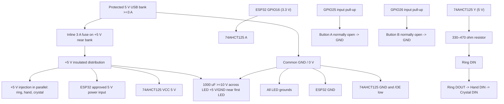

# 5 V wiring — reference, per gauntlet (NOT electrical sign-off)

Two independent copies: one for left, one for right. **Reference board ESP32-WROOM-32 DevKit**, not a verified XIAO pinout. Controller board power input and USB/VIN isolation MUST be checked against its exact schematic.

**Wiring table**: GPIO16 LED data through level shifter/resistor; GPIO25 mode button to GND; GPIO26 action button to GND; 74AHCT125 powered from 5 V with /OE tied low, common ground; capacitor across LED rails observing polarity. All unused shifter inputs need defined states per datasheet. If Adafruit #6066 is selected, use its actual documented pinout, not the bare-IC pinout.

**Critical details**:
- Power each LED zone in **parallel** from fused 5 V distribution; data is daisy-chained only if all three RGB pixel types are electrically/protocol compatible. Check data direction and color order.
- Keep controller→first pixel lead short; level shift 3.3→5 V. For long inter-zone leads, evaluate buffered outputs instead of assuming reliability.
- Place connectors on cavity side of ring notch; CAD audit found ~7 mm passage but did **not** verify connector fit. Strain relieve all moving cables.
- Place controller/bank at accessible cuff or belt, not sealed in bonded shells; reachable disconnect; protect from skin pressure. No charging while worn.
- Test with 3–5 LEDs before full installation. Measure voltage drop, peak current, bank auto-off, fuse/connector heating, 30-minute temperature and button ergonomics.
- Software brightness cap/current estimate is **not a fuse**. Final current, power connector and board power scheme require electrical review.

**V5 caution**: ring trough is digitally open in draft; accent/crystal mounting and tendon-safe cable paths are still unresolved.

## Claude review note — 2026-11-14

With the recommended 144 LEDs/m strip the chain is ring 50 → hand 34 → crystal 9 (93 px per arm). The diagram is unchanged. Two points become firmer: the WLED current limit is required (1000 mA start, 93 px can exceed the 3 A fuse at full white), and each zone should get its own 5 V/GND feed as drawn. Details: [LED_STRIP_COMPARISON](LED_STRIP_COMPARISON.md).
