# Right gauntlet: glue-up and assembly guide (Wed 2026-11-25)

Written overnight by the Finishing conversation from the CAD of your printed parts and the vault. **Nothing here has been glued or fitted by me.** Your dry-fit (11-25: "good") is the only physical result it relies on. Pictures are renders of the original arm cut at the real seam planes (right arm; the left arm is the mirror). Extends [[Finishing_Plan_2026-11-28]]. Fingers, strip, lenses, crystal, cover, gauge, pod and power bank are **not** part of this glue-up.

## 1. The short version

- **Beech rod: cut it to 249 mm.** The two socket floors in your printed R_10 / R_11 are **251.0 mm** apart (12.3 mm engagement each side). 249 leaves 2 mm of slack. **Too long = the centre seam will not close; a mm or two short is harmless.** Check on your own parts first (section 3, step 3).
- **11 glue operations in 4 rounds.** Round 1 builds six small units, round 2 joins them into three, round 3 and 4 close the arm. Plan about 8 to 9 hours of work with a wait between rounds, then **overnight to full strength (12 h)**.
- **57 dowels** (6 x 30 mm). 27 seams. Counts per step are in the table below.
- **Epoxy quantity is a risk.** The seams add up to about **1,550 cm² (0.155 m²) of glue area per arm** (computed from the CAD). At a 0.2 to 0.4 mm glue film that is roughly **35 to 70 g of mixed epoxy per arm**, so one small pack will not cover an arm. Check what you have before you start (section 3).
- **Possible blocker:** the thumb joint and the finger string test (Mechanics). They only hold up **Stage 5 and 9** (the knuckles); everything else can be glued today. Plan B is in section 5.

## 2. How the arm comes apart

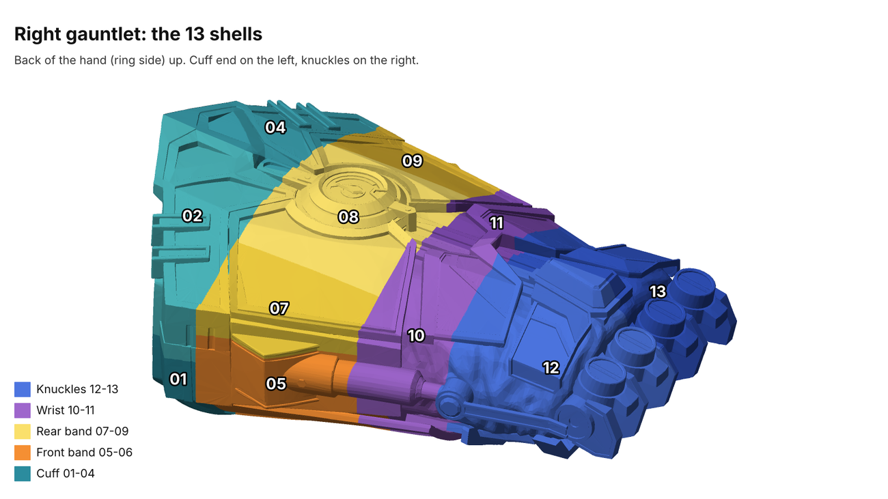

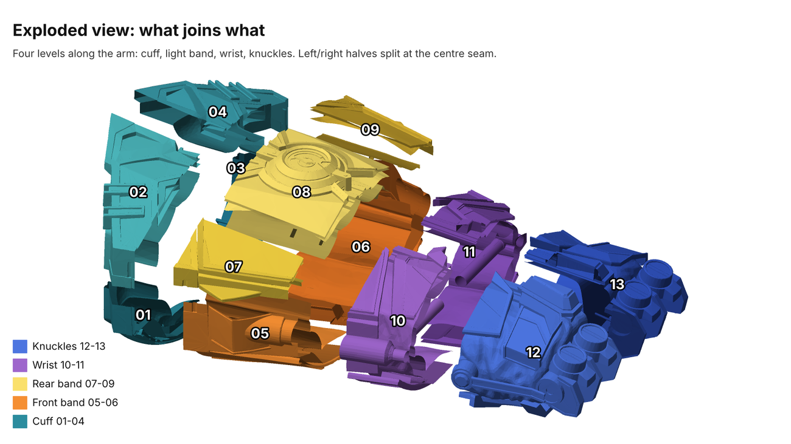

The arm is cut into four levels along its length: **cuff (01 to 04), light band (05 to 09), wrist (10 and 11), knuckles (12 and 13).** Left/right halves split at X = 211. Seam positions and dowel counts, from `V5_build_log.json`:

| Stage | Joins | Seam plane | Dowels | Round |
|---|---|---|---|---|
| 1a | 01 + 02 (cuff left half) | Y = 147 | 2 | 1 |
| 1b | 03 + 04 (cuff right half) | Y = 147 | 1 | 1 |
| 2 | 05 + 06 (front band) | X = 211 | 3 | 1 |
| 3 | 07 + 08 + 09 (rear band, ring carrier in the middle) | X = 100 and X = 300 | 3 + 3 | 1 |
| 4 | 10 + 11 with the rod (wrist) | X = 211 | 2 | 1 |
| 5 | 12 + 13 (knuckles) | X = 211 | 3 | 1 |
| 6 | cuff left half + right half | X = 211 | 3 | 2 |
| 7 | front band + rear band | Y = 180 (only 05-07 and 06-09) | 6 | 2 |
| 9 | wrist + knuckles (upper half) | Z = 400 | 6 | 2 |
| 8 | cuff + band (lower half) | Z = 145 | 15 | 3 |
| 10 | lower half + upper half (closes the arm) | Z = 310 | 10 | 4 |
| | | | **57** | |

## 3. Before you open the glue (about 45 minutes)

1. **Label the parts.** Marker on an inside face, the shell numbers 01 to 13 as in the pictures.
2. **Dry-stack everything on dowels** (you did this; do it once more on the table). Look for rocking and for any seam you cannot close by hand. Dowels that bind: ream the hole by hand with a 6.5 mm drill bit by turning it, never force a dowel.
3. **Rod.** Take the pod off the rod first. Stack 10 + 11 dry, measure **floor to floor** through the cavity with a caliper or a rule on a flat stick. CAD says 251.0 mm; **cut = your measurement minus 2 mm** (expect 249). Cut square, sand the ends flat and take off a small chamfer. Check it slides to the floor in both sockets without force; the sockets are 19.3 mm for an 18 mm rod, so the rod will have about 0.65 mm of play all round.
4. **Mark dowels at 15 mm** with a flag of tape so none bottoms out (holes are 16 mm deep on each side).
5. **Supplies:** epoxy (see quantity above), disposable gloves, isopropyl alcohol + paper towel, toothpicks, mixing card, masking tape in many short strips, ratchet or rubber straps, baking paper under the work (epoxy sticks to everything), a square and a rule, a timer. Work at 18 C or warmer.
6. **Dry-run the two hardest steps** (rod/wrist, Z = 145 cuff join) with a timer so you know how long they take.

### Epoxy technique that fits the 5 minute working time
UHU Plus Schnellfest: working time about 5 min (some packs say 2, check yours), hand-firm after about 20 min, functional after 60 min, full strength after 12 h at 20 C. Mix equal parts for a full minute on a card, use it **at once**, and only ever mix for **one seam at a time**.

- **Two-step method for any seam with several dowels** (stages 3, 8, 9, 10): first glue the dowels into **one** shell only (heavier shell), leave 20 to 30 minutes, then do a dry test fit of the pair. Only then mix fresh epoxy for the seam: a thin bead on the seam faces of both halves and a toothpick of glue in the holes of the second shell, mate, strap, wipe.
- **For the big joints (8: 15 dowels, 10: 10 dowels) consider a slower epoxy.** UHU Plus Endfest 300 has about 90 minutes working time and is also fully strong after about 12 h. It is the same family, available in hardware stores. Your call; Schnellfest also works if you rehearse.
- Wipe squeeze-out off with alcohol **within a minute or two**, especially from the hand channel, ring trough, crystal well and lens ledges. Cured epoxy there will cost you a dry-fit later.
- Do not clamp hard: light strap tension only, thin shells will warp.

## 4. The glue sequence

### Round 1: six independent units (start with 4 because it has the longest checklist)

#### Stage 4: wrist 10 + 11 with the beech rod.

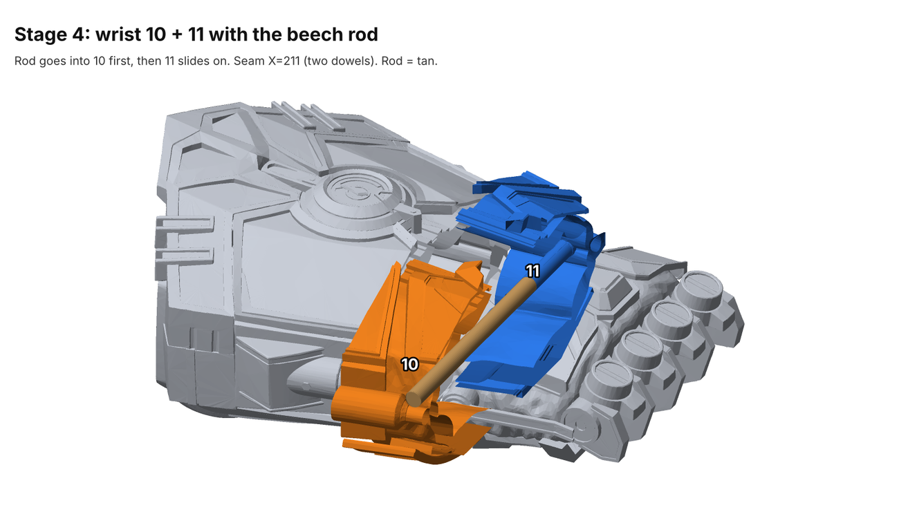
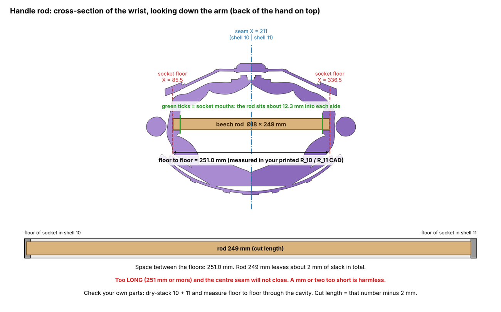

- Before: rod cut and dry-fit (section 3). Pod off the rod. Shell 10 flat on baking paper, seam face up.
- Dowels: 2 at the X = 211 seam.
- Do: (a) coat the first 15 mm of one rod end and the matching socket in shell 10 with epoxy, push the rod to the floor; it now sticks out of the seam face by about 124 mm. Support shell 10 level on blocks with the seam face up, so the rod points straight up. (b) Wait 20 to 30 minutes. (c) Mix again: epoxy on the seam faces, the 2 dowels, the free rod end and socket 11, and **slide 11 straight along the rod onto 10**; the rod, then the dowels engage only in the last 12 to 16 mm of travel. Strap, wipe.
- If you are short of time: skip the glue in socket 11 and wrap two turns of masking tape on that rod end as a shim. The rod is still captured by both sockets and the seam.
- Wiring: nothing to install here, but keep the inside of the wrist clear; the button wires pass through later (section 6).

#### Stage 1a: cuff left half 01 + 02

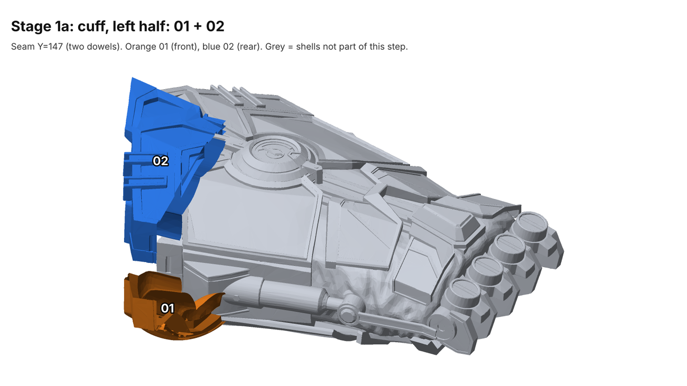
2 dowels, seam Y = 147. Dowels into 02 first, then 01 onto them. Tape across the seam in several places.

#### Stage 1b: cuff right half 03 + 04

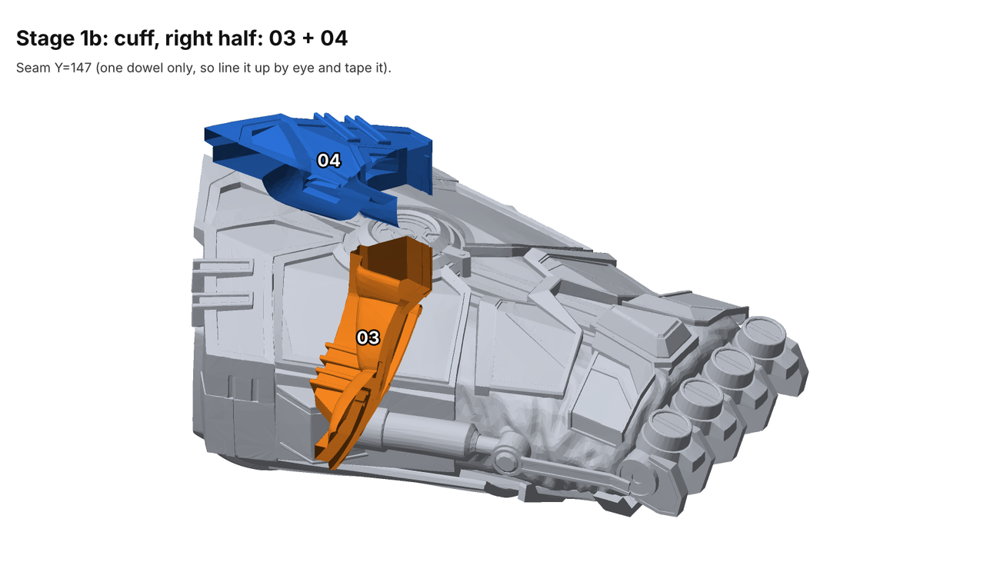
**Only 1 dowel**, so line it up by eye with a straightedge along the outside and tape it well before the epoxy sets.

#### Stage 2: front band 05 + 06

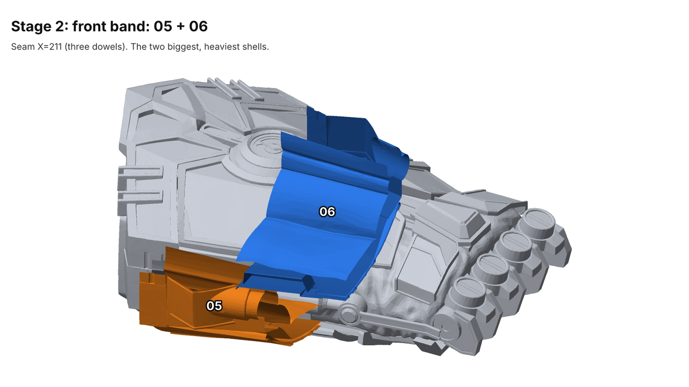
3 dowels at X = 211. These are the two biggest shells: support them on the table, do not let one hang off the edge while you mate them.

#### Stage 3: rear band 07 + 08 + 09

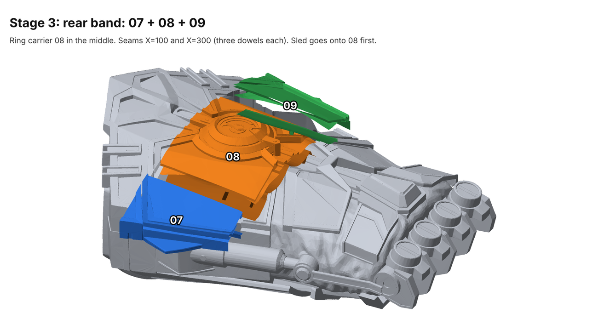

- Before: electronics decision (section 6). If the controller sled goes onto 08, it goes **now**, on the bare ceiling of 08 behind the strip exit hole under the ring (Poly Max per the Electronics notes). Keep the 16 x 12 mm exit hole clear. Nothing else of the strip or lenses is installed.
- Do 07 + 08 (X = 100, 3 dowels) first, wait 20 minutes, then 09 + 08 (X = 300, 3 dowels). Do not let squeeze-out run into the ring trough.

#### Stage 5: knuckles 12 + 13 (see the blocker in section 5)

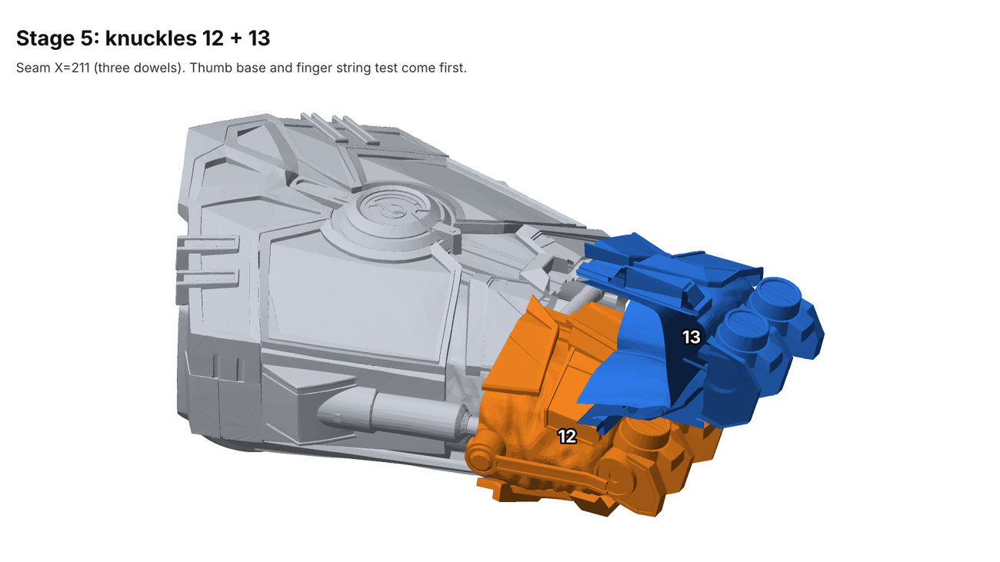

- Before: finger string test done and thumb joint decided (Mechanics). Thumb base glued with Schnellfest on the key and contact faces, **no dowel**, per the V5.5 thumb README (printed `L_` base on the right arm, plug its stray outer hole first).
- 3 dowels at X = 211. Fingers and strings are **not** installed.

### Round 2 (after 60 minutes, or 20 if you handle gently)

#### Stage 6: cuff, left half + right half

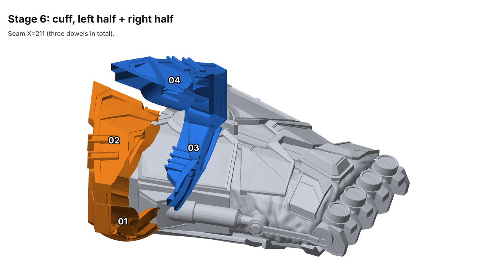
3 dowels at X = 211 (1 + 2).

#### Stage 7: band, front pair + rear trio

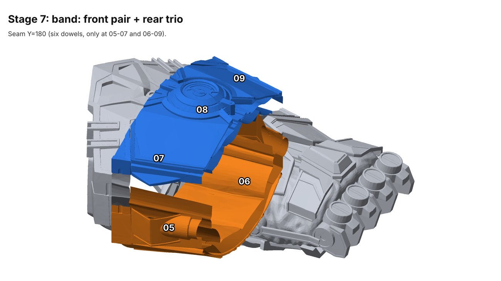
6 dowels at Y = 180. **Last chance to reach the ceiling of 08 comfortably**: this step closes the front. If the sled or board is going in, it has to be in before this stage.

#### Stage 9: upper half, wrist + knuckles

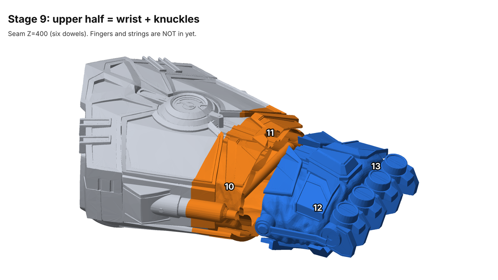
6 dowels at Z = 400. The rod and the thumb are already in. If the knuckle work is blocked, skip this (section 5).

### Round 3

#### Stage 8: lower half, cuff + band

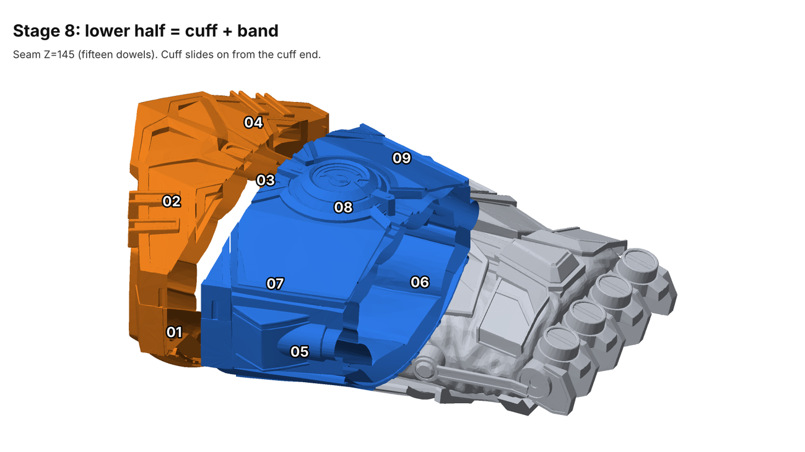
**15 dowels at Z = 145**, the big one. Two-step dowel method, slower epoxy recommended. Slide the cuff on straight along the arm axis. The power bank and Velcro come later, after paint, on a masked bare patch of the cuff wall.

### Round 4: close the arm

#### Stage 10: lower half + upper half

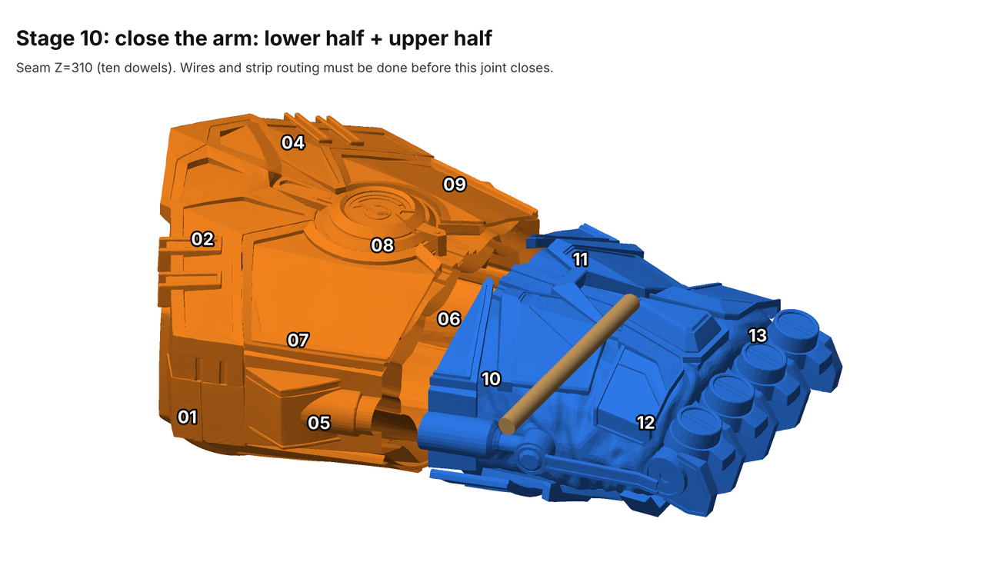
**10 dowels at Z = 310.** Before this closes: wires or strip routing that crosses this joint must already be through (section 6). Two-step method, slower epoxy. Then leave it **overnight**; do not hang anything on the handle.

### Timeline (start about 09:00; adapt)
| Time | Work |
|---|---|
| 09:00 to 09:45 | Section 3: label, dry-stack, measure and cut the rod, supplies |
| 09:45 to 11:30 | Round 1: stages 4, 1a, 1b, 2, 3 (and 5 if unblocked) |
| 11:30 to 12:30 | Hand-firm, functional strength at 60 min; lunch |
| 12:30 to 14:00 | Round 2: stages 6, 7, 9 |
| 14:00 to 15:00 | Wait |
| 15:00 to 16:15 | Round 3: stage 8 |
| 16:15 to 17:15 | Wait |
| 17:15 to 18:00 | Round 4: stage 10, then clean-up and overnight cure |

## 5. If the thumb or finger string test is not done
Skip stages 5 and 9. Close the **Body** instead: lower half (stage 8) + wrist at Z = 310, and leave the knuckles as a unit (12 + 13) with **bare seam faces masked** for later. Prime and paint the Body, then join the knuckles at Z = 400 once Mechanics has cleared them (6 dowels, epoxy on masked bare plastic).

## 6. Electronics and wiring checkpoints (from the vault)
Rule from the Electronics notes: strip and wiring go in **before** anything is bonded over them; wires that pass a seam go in before that seam closes; pods go on after.

1. **Sled and controller.** Sled glued under the ring on 08 (Poly Max), board on four M2 screws. Do it at stage 3 or at the latest before stage 7. If the board is not wired yet, put the sled in now and check with a long screwdriver on the dry-stacked arm that you can still reach the posts later.
2. **Button wires.** Run them from the board along the inside of the arm toward the handle, with 30 cm of spare, **before stage 10** closes. The pod is clipped onto the rod and wired after.
3. **USB-C cable** from the power bank (cuff wall) to the board: keep the path clear in stage 8.
4. **Strip.** Never installed before paint if it can be avoided. Test on the dry-stacked arm **tonight/this morning**: can the strip be pushed through the hand channel and its two tunnels from the open end? Yes: it goes in after paint. No: it has to be threaded before the stage that closes the channel, and the channel and strip must be masked for painting.
5. **Never glued:** ring cover, hand lenses, crystal (Poly Max dots at the very end), gauge (removable putty).

About your lens note (the channel from ring to crystal is a bit short, one long lens might be better): that does not block the glue-up, lenses go on last. A single long lens may not slide through the two bridges (22 mm and 18 mm tunnels); I have not checked the geometry yet and it would be a new insert file, so it is a question for Electronics and the Print queue.

## 7. After the glue-up
Overnight cure. Then fill, sand, prime (Finishing plan sections 6 and 7). Mask the hand channel, ring trough, crystal well and lens ledges before spraying; paint inside them thin and matte white. The overall paint look is in [[03_Decision_Log]].

## 8. If something goes wrong

- **Epoxy goes stiff in the pot:** stop, bin it, mix a fresh small batch.
- **A seam will not close:** do not squeeze it. Open it, find the dowel or the squeeze-out that binds. Check the rod length first on the wrist.
- **Parts misaligned while the epoxy is still wet:** separate within a few minutes, wipe both faces with alcohol, redo.
- **A gap remains after cure:** fill it when you prime; do not re-glue.
- **Glue got into the channel or well:** alcohol immediately; if cured, scrape with a wooden skewer and re-test the lens fit.

## Sources
UHU Plus Schnellfest data sheet (media.hornbach.de/hb/technicaldatasheet/as.46147721.pdf); UHU Plus Endfest 300 pack data on kaufland.de; repo files `V5_build_log.json`, `Build_Scripts/v5_build.py`, `V5_5_Thumb_Fix/README_V5_5_THUMB_FIX.md`, `Mechanics_Start_Here.md`, `LED_Wiring_Start_Here.md`. Seam areas and the handle socket depth were computed from `R_10_Wrist_Left_V5_1` and `R_11_Wrist_Right_V5_1` and the original arm STL.
