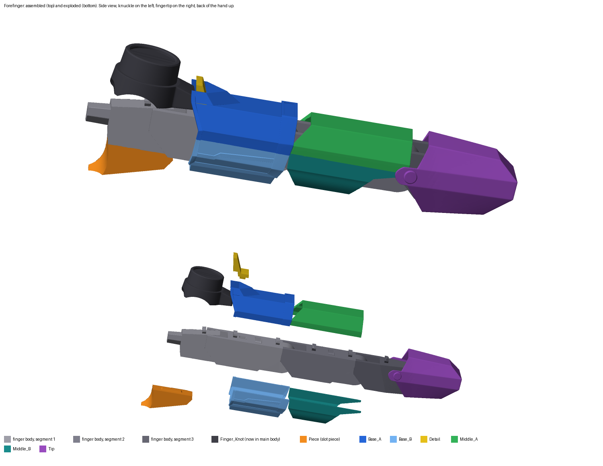
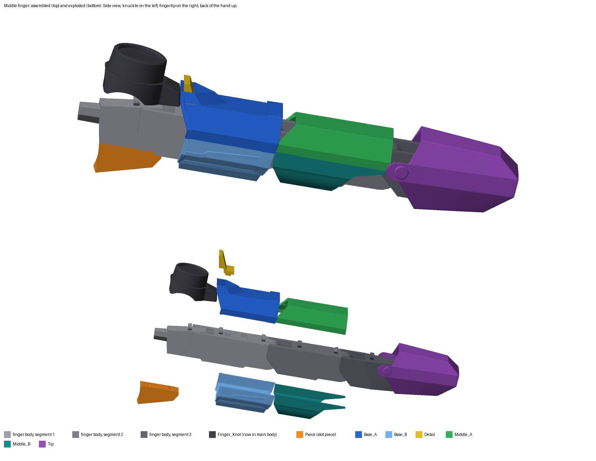
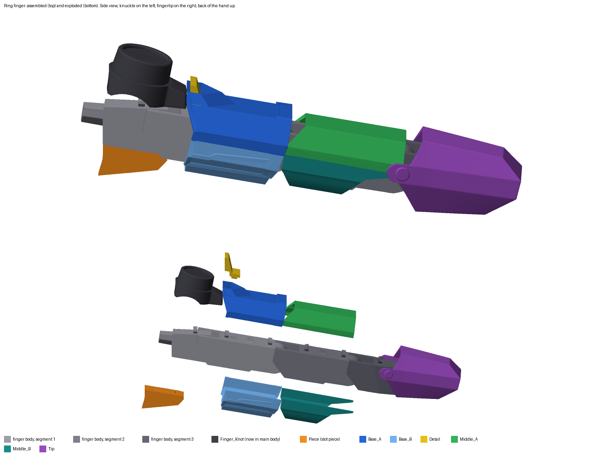
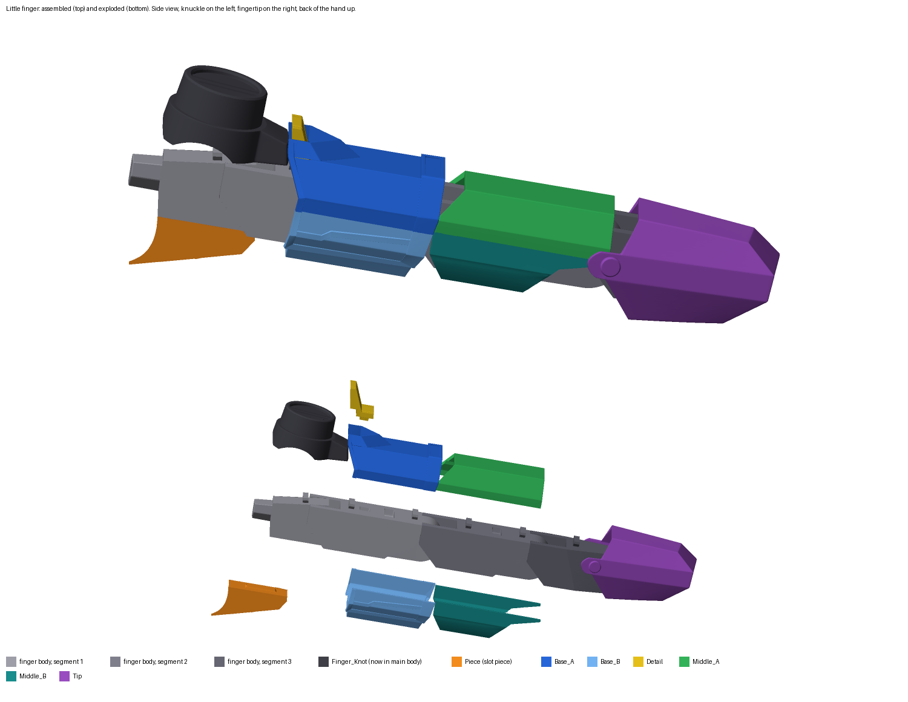
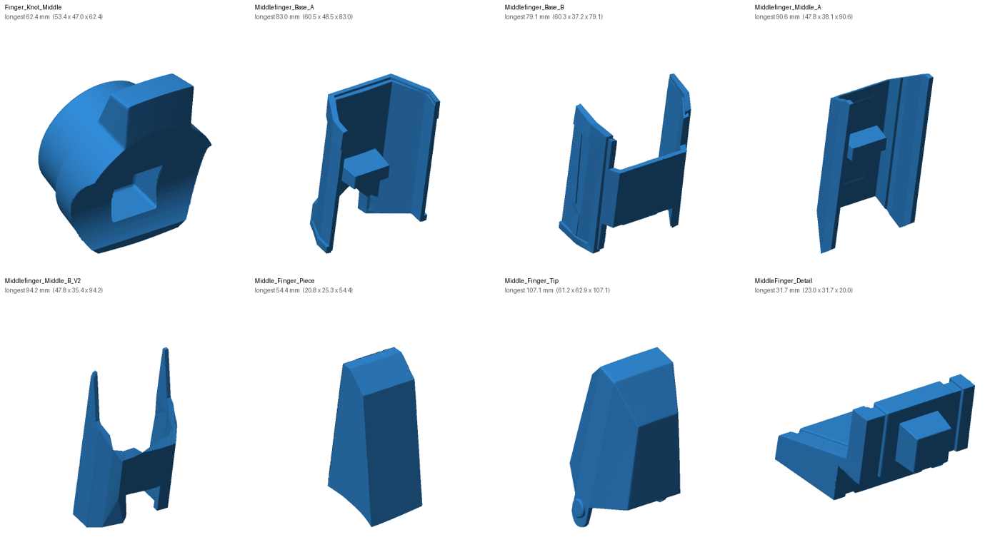

# Right arm: finger parts list (5 fingers) and mix-up sort guide

Source: `originals/Vi Gauntlet 3mf Project File.3mf` (Bambu Studio project, one hand only). Sizes are measured from the CAD in print pose, so a caliper reading on the real part may differ by 1 to 2 mm (plus primer). **Computed from the file, not checked against your physical parts.** The file shows every piece but not how they assemble; the "where it goes" column is my reading from the names and is unconfirmed until a dry fit.

## What each finger is
- **1 print-in-place finger body** (`Forefinger`, `Middle_Finger`, `Ring_Finger`, `Little_Finger`, `Thumb`), printed flat; these are the moving parts, do not paint or glue them.
- **Shell pieces** that go over the body: 7 per finger (4 fingers) or 4 for the thumb. That is **32 shell pieces + 5 bodies = 37 parts**.
- **Owner correction 2026-11-27:** in the design actually printed, the knuckle caps (`Finger_Knot`) are built into the main body (not the thumb). They are removed from this list. This 3MF is the *original* design, kept as a finger reference only, so other pieces may differ from what you printed too: check the sheets against your pieces.

## Checklist (tick when found, primed, painted, glued)
| Piece | Fore | Middle | Ring | Little | Thumb | Probable job |
|---|---|---|---|---|---|---|
| Finger body (print-in-place) | [ ] | [ ] | [ ] | [ ] | [ ] | the moving finger; stays unpainted |
| Base_A | [ ] | [ ] | [ ] | [ ] | - | armour plate at the knuckle end of the finger |
| Base_B | [ ] | [ ] | [ ] | [ ] | - | wraps the base segment |
| Middle_A | [ ] | [ ] | [ ] | [ ] | [ ] | middle segment |
| Middle_B (V2) | [ ] | [ ] | [ ] | [ ] | [ ] | middle segment |
| Piece | [ ] | [ ] | [ ] | [ ] | - | **slot piece: press-fits into the knuckle slot in shells 12/13** (do not build up paint on its press faces) |
| Tip | [ ] | [ ] | [ ] | [ ] | [ ] | fingertip |
| Detail | [ ] | [ ] | [ ] | [ ] | - | small detail piece (about 32 mm) |
| Thumb_Base | - | - | - | - | [ ] | goes into knuckle 13 with the thumb joint, not on the finger |

## Comparison with the current design (shells 12/13 V5.1), from the V5.2 simulation report
Existing vault result (`V5_2_SIMULATION_REPORT.md` section 5, computed, not physical): the finger parts that touch the knuckle shells are the **finger core** (first segment) and the **slot Piece**. In the 3MF the printable core and Piece volumes match the assembled reference to 0.03 cm3 or better (middle core 0.24 cm3 apart, possibly a small revision). Against shells 12/13 V5.1: cores clear with a typical 0.8 to 1.8 mm gap; **Pieces overlap by at most 0.15 mm, a snug press fit as designed.** The Finger_Knot caps were skipped in that check, which fits your statement that the knot is now part of the main moulded body; I have **not** checked the knot geometry against the shells myself. The reference copy of Base_A is an older revision (about 0.7 % smaller in volume than the printable one), a minor difference. The physical T2 coupon PASS (11-18) is the real confirmation of the slot fit.

Practical consequence: the **Piece is the part where paint thickness matters** (primer plus paint adds about 0.05 to 0.15 mm per surface). Test-fit every primed Piece into its slot before painting; keep paint off its press faces.

## Assembly pictures (from `originals/Together For Sizing.stl`, the assembled reference with all four fingers)
The project 3MF has no assembled pose, but the sizing model does. I matched each piece in it to the printable parts by volume and position, then drew each finger assembled and pulled apart. **Computed from CAD, not fitted by hand.** Side view: knuckle on the left, fingertip on the right, back of the hand up (+Y).

How one finger goes together, from the pictures (same layout on all four fingers):
1. **Finger body** = 3 print-in-place segments in a row (grey). Small tabs on the top edge of the body look like the places the plates clip or glue onto: confirm on the dry fit.
2. **Piece** (orange) sits under the root of segment 1 on the palm side and presses into the knuckle slot (up to 0.15 mm overlap).
3. **Base_A** (dark blue, back side) and **Base_B** (light blue, palm side) wrap segment 1 as a pair of halves, just past the knuckle.
4. **Detail** (gold) is the small fin on top of Base_A.
5. **Middle_A** (green, back) and **Middle_B** (teal, palm side) wrap segment 2 the same way.
6. **Tip** (purple) caps segment 3 and has a round pin boss on each side at its hinge end.
7. **Finger_Knot** (black cap at the top left) is shown only because the reference has it as a separate part. In your design it is part of the main knuckle body, so **ignore it**.

Differences between the reference and your printable parts: the reference Base_B and Middle_A are **older, thicker revisions** (Base_B about 21 % and Middle_A about 13 % larger in volume); the printable Base_B and Middle_B_V2 are the newer slimmer ones. Base_A, Piece, Detail, Tip and Middle_B_V2 match. The bodies' hinge geometry was not checked.

The **thumb** is not drawn: its pieces sit differently (Thumb_Base joins the knuckle shell, see Mechanics) and I have not matched them yet.

## If they are mixed up: sort in two steps
**Step 1, by shape** (the sheets below): seven piles of piece types. The thumb pieces are big (73 to 115 mm) and unmistakable.

**Step 2, by finger**, longest edge in mm (caliper, expect plus or minus 2 with primer):

| Piece | Fore | Middle | Ring | Little |
|---|---|---|---|---|
| Base_A | 82.6 | 83.0 | 83.0 | 80.7 |
| Base_B | 78.7 | 79.1 | 79.1 | 76.9 |
| Middle_A | 90.9 | 90.6 | 91.2 | 88.8 |
| Middle_B | 93.7 | 94.2 | 94.2 | 91.6 |
| Piece | 65.4 | 54.4 | 53.8 | 64.4 |
| Tip | 94.9 | 107.1 | 106.3 | 98.6 |
| Detail | 31.8 | 31.8 | 31.7 | 31.7 |

How to read it:
- **Little** is the smallest in every row. **Fore** and **Little** pieces are about 65 mm; **Middle/Ring** pieces are about 54 mm. The Tip separates all three groups (95 / 99 / 106 to 107).
- **Middle and Ring are practically the same design** (differences under 1 mm in every piece). If those two get swapped, a dry fit on the body will show; the shells are probably interchangeable between them.
- **Detail pieces are identical** across fingers (31.7 to 31.8 mm).
- **Mirrored left-hand copies:** this project is one hand. If you also printed a mirrored set for the left arm, a mirrored piece looks like the reflection of the picture on the sheet; keep any mirrored piece for the left arm.

## Piece sheets (as modelled, blue = shell piece; sizes in mm)
### Forefinger

### Middle finger

### Ring finger

### Little finger

### Thumb

