# Vi Gauntlet V5 — Parts Inventory

Checklist of every part for each arm. Tick ☐ → ☑ (or write the date) as parts come off the printer.

- Pictures are renders of the actual print files, not photos. They show each part in its **print orientation**, so the left-arm pictures look different from the right: the left parts are mirror images.
- Sizes are the print bounding box in mm.
- **Left-arm naming:** left shells keep the right arm's side names (`L_01_Cuff_Left_Front` actually sits on the other side). Label parts as they come off the printer.
- **Shell 08 must be `_V5_2`** (from the print pack). The `_V5_1` file still in the repo is superseded.
- **Left inserts:** use the files from `L_Inserts_Normals_Fix.zip`, not the older ones in `7_Left_Arm`.

**Count per arm:** 13 shells + 5 printed inserts + 1 handle = 19 printed parts, plus 57 wooden dowels and the electronics.

---

## Right arm

### Right shells (13) — lightweight PLA

| ☐ | # | Picture | File | What it is | Size (mm) | Printer |
|---|---|---|---|---|---|---|
| ☐ | 01 | 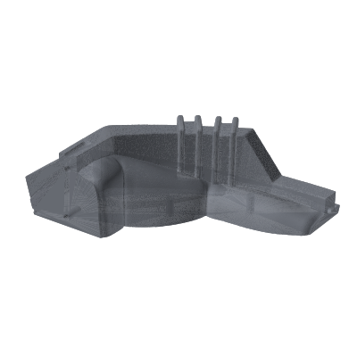 | `R_01_Cuff_Left_Front_V5` | Cuff, front (side A) | 210 × 147 × 71 | X1C |
| ☐ | 02 |  | `R_02_Cuff_Left_Rear_V5` | Cuff, rear (side A) | 210 × 147 × 145 | X1C |
| ☐ | 03 |  | `R_03_Cuff_Right_Front_V5` | Cuff, front (side B) | 209 × 147 × 71 | X1C |
| ☐ | 04 | 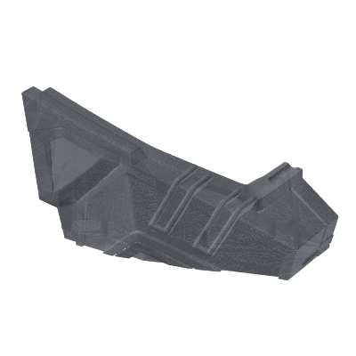 | `R_04_Cuff_Right_Rear_V5` | Cuff, rear (side B) | 209 × 147 × 145 | X1C |
| ☐ | 05 |  | `R_05_LightBand_Front_Left_V5` | Light band, front (side A) | 211 × 178 × 165 | X1C |
| ☐ | 06 |  | `R_06_LightBand_Front_Right_V5` | Light band, front (side B) | 211 × 178 × 165 | X1C |
| ☐ | 07 | 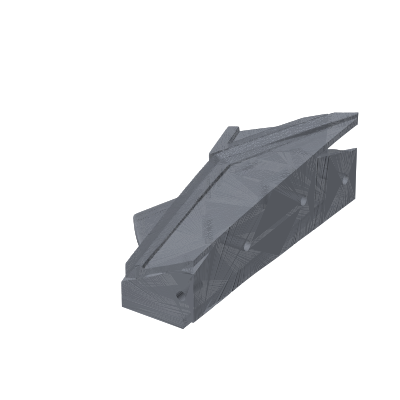 | `R_07_LightBand_Rear_Left_V5` | Light band, rear (side A), small | 165 × 100 × 66 | A1 Mini or X1C |
| ☐ | 08 | 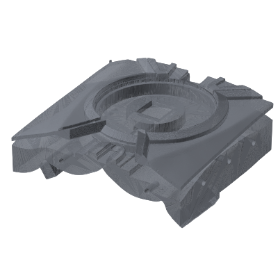 | `R_08_LightBand_Rear_RingCarrier_V5_2` | Ring carrier: holds the LED ring and cover | 200 × 165 × 84 | X1C |
| ☐ | 09 | 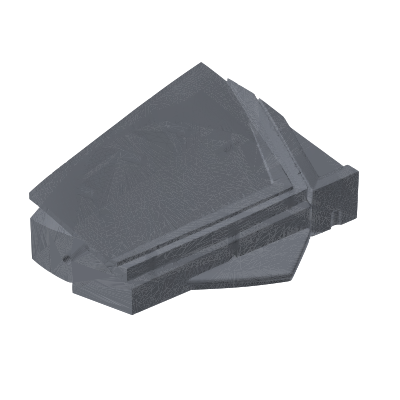 | `R_09_LightBand_Rear_Right_V5` | Light band, rear (side B), small | 165 × 122 × 72 | A1 Mini or X1C |
| ☐ | 10 | 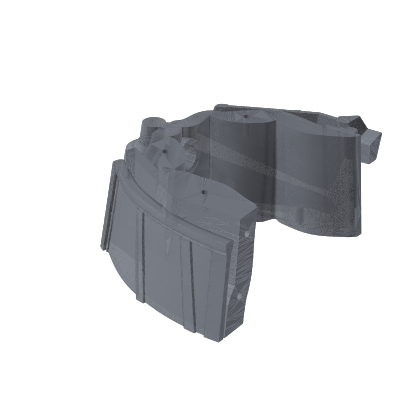 | `R_10_Wrist_Left_V5_1` | Wrist (side A), handle socket | 225 × 181 × 90 | X1C |
| ☐ | 11 | 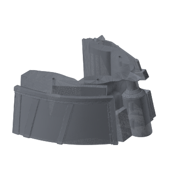 | `R_11_Wrist_Right_V5_1` | Wrist (side B), handle socket | 225 × 181 × 90 | X1C |
| ☐ | 12 | 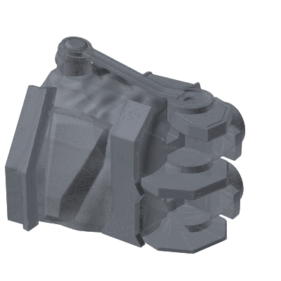 | `R_12_Knuckles_Left_V5_1` | Knuckles (side A), finger slots | 200 × 199 × 166 | X1C |
| ☐ | 13 | 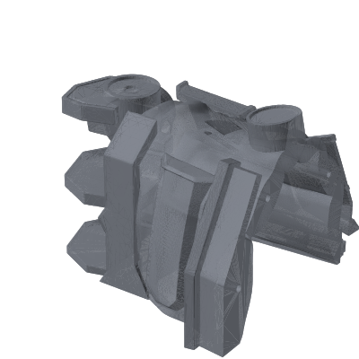 | `R_13_Knuckles_Right_V5_1` | Knuckles (side B), finger slots | 200 × 199 × 158 | X1C |

### Right inserts (5)

| ☐ | Picture | File | What it is | Size (mm) | Material | Printer |
|---|---|---|---|---|---|---|
| ☐ | 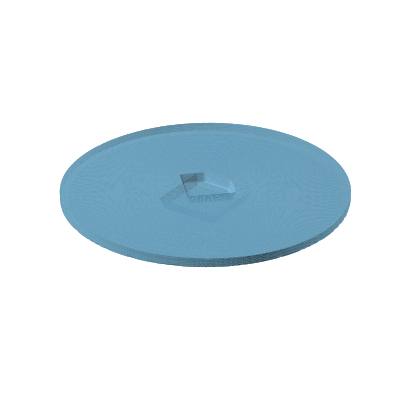 | `R_Ring_Light_Cover_translucent` | Ring light cover | 118 × 118 × 9 | Transparent PLA | A1 Mini |
| ☐ | 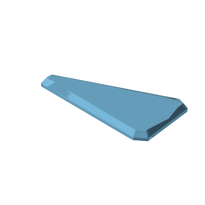 | `R_Crystal_translucent` | Crystal | 65 × 37 × 6 | Transparent PLA | A1 Mini |
| ☐ | 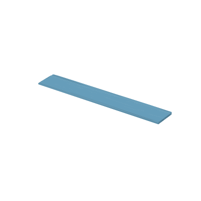 | `R_Hand_Lens_A_translucent_81mm` | Hand lens A (long, 81 mm) | 81 × 13 × 2 | Transparent PLA | A1 Mini |
| ☐ |  | `R_Hand_Lens_B_translucent_46mm` | Hand lens B (short, 46 mm) | 46 × 13 × 2 | Transparent PLA | A1 Mini |
| ☐ |  | `R_Pressure_Gauge_Insert` | Pressure gauge | 185 × 109 × 33 | Opaque PLA (any) | X1C |

### Right handle and hardware

| ☐ | Picture | Item | Qty | Notes |
|---|---|---|---|---|
| ☐ | 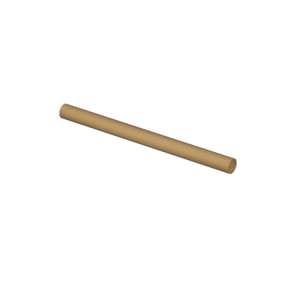 | Handle: `Handle_OnePiece_18p8x250` **or** 18 mm beech rod cut to 250 mm | 1 | Standard PLA/PETG, not LW-PLA. Fit into shells 10 + 11 **before** joining them |
| ☐ | | Wooden dowels 6 × 30 mm | 57 | Holes are 6.4 mm; test fit in 07/09 first |
| ☐ | | Adafruit Sparkle Motion Mini | 1 | LED controller (USB-C) |
| ☐ | | BTF 5 mm 160/m strip, 91 LEDs (ring 55 + hand 36) | ≈ 0.57 m | Cut on the copper pads only |
| ☐ | | JST-SM 3-pin pigtail (strip → board) | 1 | Red → 5V, green → 32, white → G |
| ☐ | | 12 × 12 mm tactile buttons + caps | 2 | GPIO 14 and 27 to G |
| ☐ | | USB-C power bank + short USB-C cable | 1 each | |
| ☐ | | 24 AWG silicone wire, heat shrink | — | Shared stock |
| ☐ | 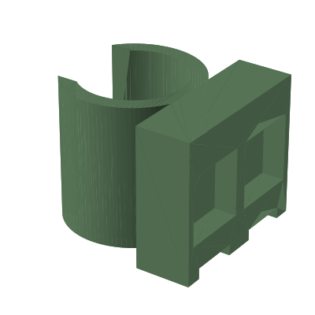 | Button pod (`Button_Pod_Handle_Clip_2x_12mm_tact_CONCEPT`) | 1 | **Concept**: print only once the buttons are here, and check the fit |
| ☐ | 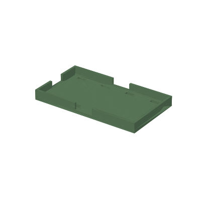 | Electronics sled (`Electronics_Sled_80x45_CONCEPT`) | 1 | **Don't print yet.** It was sized for the old board and needs redoing for the 32 × 20 mm Sparkle Motion Mini |

---

## Left arm

### Left shells (13) — lightweight PLA

| ☐ | # | Picture | File | What it is | Size (mm) | Printer |
|---|---|---|---|---|---|---|
| ☐ | 01 | 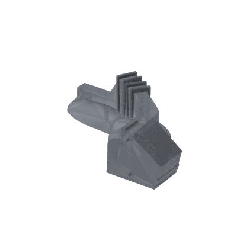 | `L_01_Cuff_Left_Front_V5` | Cuff, front (side A) | 210 × 147 × 71 | X1C |
| ☐ | 02 | 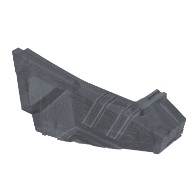 | `L_02_Cuff_Left_Rear_V5` | Cuff, rear (side A) | 210 × 147 × 145 | X1C |
| ☐ | 03 | 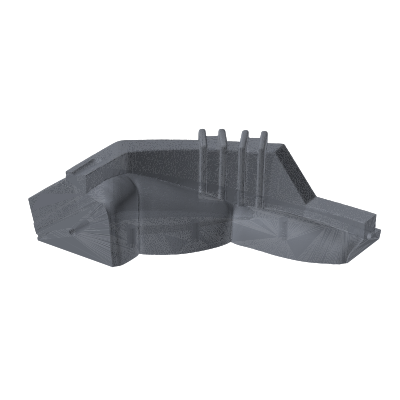 | `L_03_Cuff_Right_Front_V5` | Cuff, front (side B) | 209 × 147 × 71 | X1C |
| ☐ | 04 | 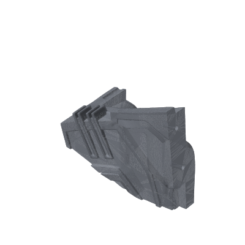 | `L_04_Cuff_Right_Rear_V5` | Cuff, rear (side B) | 209 × 147 × 145 | X1C |
| ☐ | 05 | 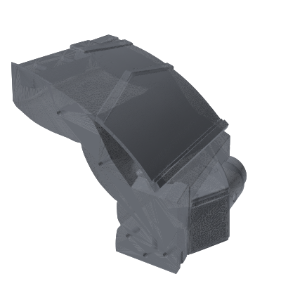 | `L_05_LightBand_Front_Left_V5` | Light band, front (side A) | 211 × 178 × 165 | X1C |
| ☐ | 06 | 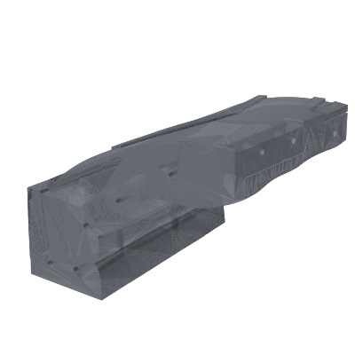 | `L_06_LightBand_Front_Right_V5` | Light band, front (side B) | 211 × 178 × 165 | X1C |
| ☐ | 07 | 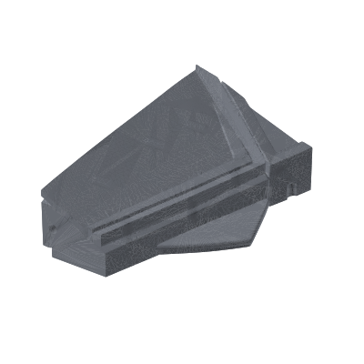 | `L_07_LightBand_Rear_Left_V5` | Light band, rear (side A), small | 165 × 100 × 66 | A1 Mini or X1C |
| ☐ | 08 | 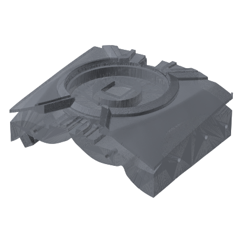 | `L_08_LightBand_Rear_RingCarrier_V5_2` | Ring carrier: holds the LED ring and cover | 200 × 165 × 84 | X1C |
| ☐ | 09 | 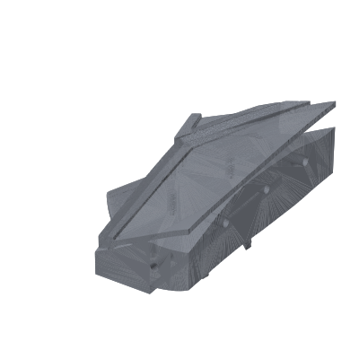 | `L_09_LightBand_Rear_Right_V5` | Light band, rear (side B), small | 165 × 122 × 72 | A1 Mini or X1C |
| ☐ | 10 |  | `L_10_Wrist_Left_V5_1` | Wrist (side A), handle socket | 225 × 181 × 90 | X1C |
| ☐ | 11 |  | `L_11_Wrist_Right_V5_1` | Wrist (side B), handle socket | 225 × 181 × 90 | X1C |
| ☐ | 12 | 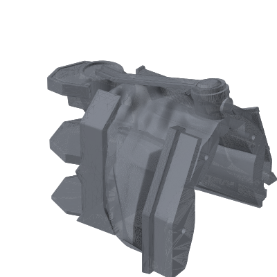 | `L_12_Knuckles_Left_V5_1` | Knuckles (side A), finger slots | 200 × 199 × 166 | X1C |
| ☐ | 13 | 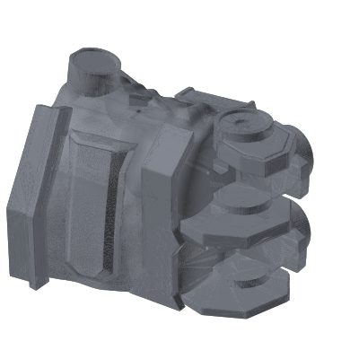 | `L_13_Knuckles_Right_V5_1` | Knuckles (side B), finger slots | 200 × 199 × 158 | X1C |

### Left inserts (5)

| ☐ | Picture | File | What it is | Size (mm) | Material | Printer |
|---|---|---|---|---|---|---|
| ☐ | 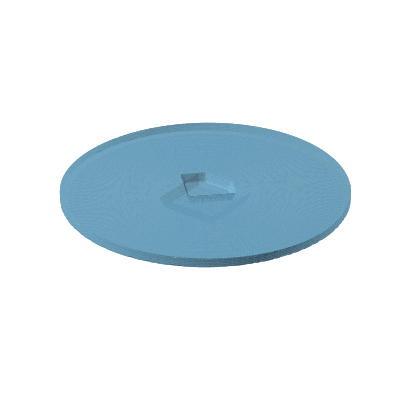 | `L_Ring_Light_Cover_translucent` | Ring light cover | 118 × 118 × 9 | Transparent PLA | A1 Mini |
| ☐ | 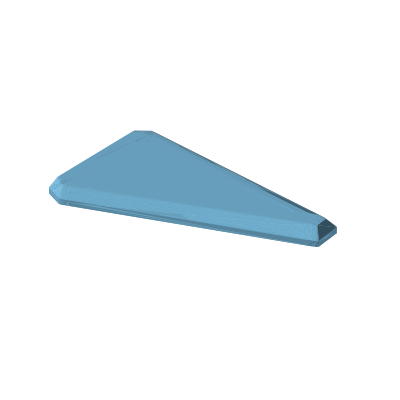 | `L_Crystal_translucent` | Crystal | 65 × 37 × 6 | Transparent PLA | A1 Mini |
| ☐ | 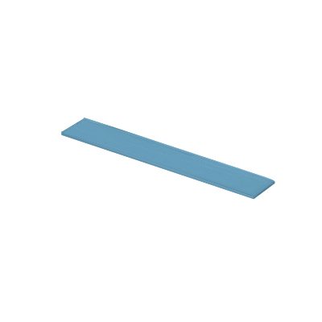 | `L_Hand_Lens_A_translucent_81mm` | Hand lens A (long, 81 mm) | 81 × 13 × 2 | Transparent PLA | A1 Mini |
| ☐ | 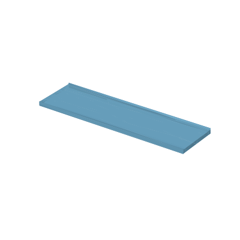 | `L_Hand_Lens_B_translucent_46mm` | Hand lens B (short, 46 mm) | 46 × 13 × 2 | Transparent PLA | A1 Mini |
| ☐ | 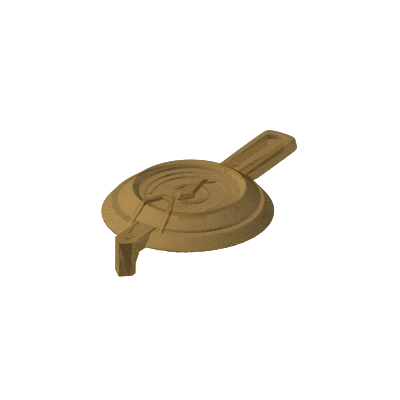 | `L_Pressure_Gauge_Insert` | Pressure gauge | 185 × 109 × 33 | Opaque PLA (any) | X1C |

### Left handle and hardware

| ☐ | Picture | Item | Qty | Notes |
|---|---|---|---|---|
| ☐ |  | Handle: `Handle_OnePiece_18p8x250` **or** 18 mm beech rod cut to 250 mm | 1 | Standard PLA/PETG, not LW-PLA. Fit into shells 10 + 11 **before** joining them |
| ☐ | | Wooden dowels 6 × 30 mm | 57 | Holes are 6.4 mm; test fit in 07/09 first |
| ☐ | | Adafruit Sparkle Motion Mini | 1 | LED controller (USB-C) |
| ☐ | | BTF 5 mm 160/m strip, 91 LEDs (ring 55 + hand 36) | ≈ 0.57 m | Cut on the copper pads only |
| ☐ | | JST-SM 3-pin pigtail (strip → board) | 1 | Red → 5V, green → 32, white → G |
| ☐ | | 12 × 12 mm tactile buttons + caps | 2 | GPIO 14 and 27 to G |
| ☐ | | USB-C power bank + short USB-C cable | 1 each | |
| ☐ | | 24 AWG silicone wire, heat shrink | — | Shared stock |
| ☐ |  | Button pod (`Button_Pod_Handle_Clip_2x_12mm_tact_CONCEPT`) | 1 | **Concept**: print only once the buttons are here, and check the fit |
| ☐ |  | Electronics sled (`Electronics_Sled_80x45_CONCEPT`) | 1 | **Don't print yet.** It was sized for the old board and needs redoing for the 32 × 20 mm Sparkle Motion Mini |

---

## Shared / already done

| ☐ | Item | Notes |
|---|---|---|
| ☑ | `T2_Knuckle_Slot_Forefinger_Coupon` | Printed, finger fits (2026-11-18). Test piece only |
| ☐ | Fingers (stock model, both hands) | Printed separately; not part of this pack |
| ☐ | 2-part epoxy (UHU Plus Schnellfest ×2) | Dowels and seams |
| ☐ | UHU Poly Max (clear) | Covers, lenses, electronics. No super glue near clear parts |

*Generated 2026-11-21 by Claude from the V5 print pack files. Renders by `Build_Scripts/inventory_render.py`.*
